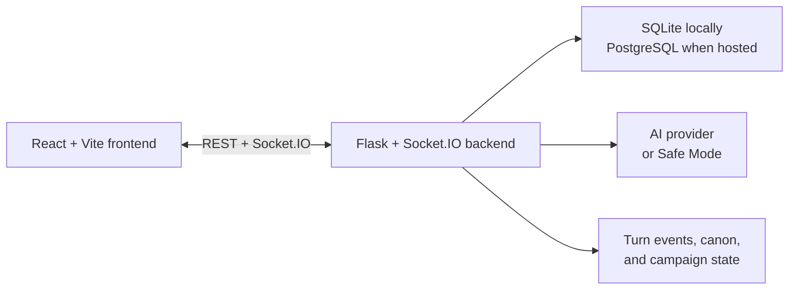

# AI-DM

**A persistent AI Dungeon Master and live tabletop console for story-driven
campaigns.**

[Play the live beta](https://playaidm.com) ·
[Explore the documentation](#documentation) ·
[Report an issue](https://github.com/dreichner2/AI-DM/issues)

AI-DM brings the campaign, party, live table, rules helpers, and AI narration
into one place. It remembers what happened, applies structured state changes,
and carries the world's canon forward from one session to the next.

> [!NOTE]
> AI-DM is under active development and is currently a closed beta. The hosted
> build requires an account; the repository can also be run entirely on your
> own machine.

## What makes it different

A normal chatbot can narrate a scene. AI-DM maintains the game around that
scene.

- **A story you read, not a dashboard** — the Story view is the game: the
  narration, a quiet line under each turn saying what changed (a clue found, a
  check made, damage taken, a new place on the map), suggestions that are always
  actions the rules allow, and a drawer with your character, magic, journal and
  an inked map of the places you know.
- **Rules that hold** — the server rolls every die and resolves attacks, 61
  spells, class features for levels 1–5 of the twelve core classes, conditions,
  dying and death saves, potions, rests, the day clock and shops before the
  narrator speaks. Narration cannot invent damage, items or success.
- **Your words count** — typing "I take the key" or "search the bench" does
  exactly what the matching button does; a failed search can be retried by
  taking your time.
- **A ready-made adventure** — *The Road of Unremembered Kings* plays start to
  finish: four ready-made heroes, seven places, fights that scale to your party,
  choices that change the fights, and four endings.
- **One continuing campaign** — each session is a chapter; the world, quests and
  characters carry forward, and saves export and restore.
- **A live shared table** — streaming turns, presence, turn order that skips an
  absent player, music, and clarification prompts over Socket.IO.
- **Table tools** — create or import adventures, manage encounters and maps,
  inspect state, and export a campaign Chronicle.
- **Flexible AI** — narrate with Codex, Gemini, DeepSeek or NVIDIA/Kimi, or play
  fully offline with the scripted narrator (Safe Mode).

## Start playing

### Your first minute

1. The title screen offers *The Road of Unremembered Kings*. Pick one of the
   four ready-made heroes and press **Play now as …** (or **Create your own
   adventure** to start another bundled pack, or a blank page once an AI narrator
   is connected, and make a hero with guided creation). Returning players see
   **Continue your adventure** with where they left off.
2. The Story view opens on the authored opening: an empty caravan at a roadside
   inn at dusk. Tap a suggestion, open the action tray (or press `/`), or type
   what you do.
3. The adventure menu holds the next chapter, your other adventures, the
   Chronicle and save export, Settings, and **Table tools** for the full
   console.

The scripted narrator plays the ready-made adventure fully offline: no key, no
network. To narrate with an AI instead, give the server a provider key (see
[Connect an AI provider](#connect-an-ai-provider)) and choose it in
**Settings → Narrator**, which lists the providers the server has keys for.

### Use the hosted beta

1. Open [playaidm.com](https://playaidm.com).
2. Sign up and create or join a table.
3. Choose **Play now** for the ready-made adventure, or create your own.

### Run it locally

You will need:

- Python 3.14 (3.14.6 or newer)
- Node.js 24 (24.18 or newer)
- npm 12
- a Unix-like shell

CI uses the exact versions in [.python-version](.python-version) and
[.nvmrc](.nvmrc). `make install`, `make unified` and the launch scripts accept
any version above; `python3.14 scripts/check_toolchain.py python node npm` shows
whether yours qualify.

```bash
git clone https://github.com/dreichner2/AI-DM.git
cd AI-DM
make install
make unified
```

Then open [http://127.0.0.1:5050](http://127.0.0.1:5050).

`make unified` builds the frontend when needed and serves the UI, API,
Socket.IO, and TTS routes from one local origin. Check the running backend with:

```bash
curl http://127.0.0.1:5050/api/health
```

No provider key is required. Without one, AI-DM narrates with the scripted
narrator (Safe Mode): the ready-made adventure plays to any of its endings, and
free-form words the scripted narrator cannot map to an action get a short note
pointing to the suggestions.

## Connect an AI provider

Local settings live in `.env.local`, which is loaded automatically and ignored
by Git.

```bash
cp .env.local.example .env.local
```

Choose one provider:

| Provider | Minimal local configuration |
| --- | --- |
| Codex CLI | `AIDM_LLM_PROVIDER=codex_cli` with Codex installed and a dedicated signed-in `AIDM_CODEX_HOME`; AIDM runs it as a host-isolated narrator |
| Gemini | `GOOGLE_GENAI_API_KEY=...` |
| DeepSeek | `AIDM_DEEPSEEK_API_KEY=...` |
| NVIDIA / Kimi | `AIDM_NVIDIA_API_KEY=...` |
| Safe Mode | No key, or `AIDM_LLM_PROVIDER=fallback` |

When `AIDM_LLM_PROVIDER` is omitted, the local launcher detects Gemini,
DeepSeek, then NVIDIA credentials before falling back to Safe Mode. Models and
provider capabilities are defined in
[aidm_server/provider_registry.py](aidm_server/provider_registry.py).

### Narrator voice

The narration can also be read aloud. The server chooses the voice from
`AIDM_TTS_PROVIDER` (`openai` or `deepgram`); left unset, it uses OpenAI when
`AIDM_OPENAI_API_KEY` (or `OPENAI_API_KEY`) is set, else Deepgram when
`AIDM_DEEPGRAM_API_KEY` is set. OpenAI narrates through its Realtime models,
because its older speech models (`tts-1`, `tts-1-hd`, `gpt-4o-mini-tts`) are
removed on 6 January 2027. Players pick a voice, an accent and a quality in
**Settings → Sound**: **Best** (`gpt-realtime-2.1`, about 6 cents for a
~40-second narrated turn at list prices) or **Faster**
(`gpt-realtime-2.1-mini`, under 2 cents). `AIDM_OPENAI_TTS_MODEL`,
`AIDM_OPENAI_TTS_VOICE` and `AIDM_OPENAI_TTS_ACCENT` set the server's defaults.
Voice keys, like every provider key, live only in the server environment; the
browser never sees them.

### Sound

Besides the music and the narrator's voice, the Story view can play a quiet
ambience bed for the party's place (rain, wind, a hearth, night insects, a
marsh, a cave) and short cues when a fight starts or is won or lost, and for a
clue or a new level. Every one of these sounds is generated in the browser with
the Web Audio API: no audio files, no provider, no key. Both are off until the
player turns them on in **Settings → Sound** (**Ambience** and **Effects**, each
with a volume); nothing plays before the player's first click or key press, and
the bed drops while the narrator speaks.
A campaign pack chooses a place's bed and its weather (rain, fog or snow drawn
behind the story) with the location fields `ambience` and `weather`; see
[docs/campaign_packs.md](docs/campaign_packs.md).

Never commit `.env.local` or paste real credentials into logs, issues, or
screenshots.

The Codex adapter does not expose the repository, service environment, shell,
network, web search, apps, plugins, skills, MCP, or host configuration to
gameplay prompts. Each turn runs in an empty read-only disposable workspace.
The pinned CLI can still offer a small set of built-in local utility tools;
filesystem permissions confine them to that empty workspace and required
runtime files, while AIDM rejects any structured tool event present in Codex's
JSONL output. Saved-login deployments must use a persistent, AIDM-only
`AIDM_CODEX_HOME` so token refreshes persist without loading a user's Codex
configuration or history.

## Development

For Vite hot reload, run the backend and frontend separately:

```bash
# Terminal 1
make backend
```

```bash
# Terminal 2
make frontend
```

The Vite app proxies API and Socket.IO traffic to the local backend.

### Useful commands

| Command | Purpose |
| --- | --- |
| `make install` | Create the virtualenv and install pinned backend/frontend dependencies |
| `make unified` | Build and run the complete single-origin app |
| `make backend` | Run the Flask/Socket.IO backend |
| `make frontend` | Run the Vite development server |
| `make test` | Run the backend test suite |
| `cd aidm_frontend && npm run test` | Type-check, lint, and test the frontend |
| `make dev-check` | Run the fast local correctness and drift checks |
| `make browser-smoke` | Exercise the main flow in a real browser |
| `make play-now-smoke` | Play the ready-made adventure to an ending and check what the player reads |
| `make closed-beta-rc` | Run the full closed-beta release-candidate gate |

Release engineering, evidence generation, and hosted operations commands are
documented in the [release checklist](docs/release_checklist.md) and
[beta runbook](docs/beta_runbook.md).

## How it fits together



- [`aidm_frontend/`](aidm_frontend/) contains the React interface, session
  board, campaign tools, and client-side runtime state.
- [`aidm_server/`](aidm_server/) contains the API, sockets, turn engine,
  providers, rules, state services, and deployment bootstrap.
- [`tests/`](tests/) contains backend coverage; frontend tests live beside their
  components in `aidm_frontend/src/`.
- [`migrations/`](migrations/) contains the Alembic database history.
- [`scripts/`](scripts/) contains local launchers, authoring tools, smoke tests,
  repair utilities, and release checks.

Local data is stored in `~/.aidm/dnd_ai_dm.db` by default. Hosted environments
use PostgreSQL and must run the checked migration and production bootstrap
paths.

## Campaign packs

Campaign packs are structured JSON adventures. They can define locations,
NPCs, quests, encounters, branches, checkpoints, hidden information, and
progress rules, then be linted and imported into AI-DM.

Start with:

- [Campaign pack guide](docs/campaign_packs.md)
- [JSON schema](docs/campaign_pack.schema.json)
- [Example adventures](docs/examples/)

Validate a pack before importing it:

```bash
.venv/bin/python scripts/aidm_pack.py lint path/to/campaign.json
```

## Documentation

| If you want to understand... | Read |
| --- | --- |
| The current application design | [Architecture](docs/architecture.md) |
| Where runtime state belongs | [Runtime state boundaries](docs/runtime_state_boundaries.md) |
| Campaign-pack authoring | [Campaign packs](docs/campaign_packs.md) |
| Local, private, and hosted authentication | [Auth modes](docs/auth_modes.md) |
| Joining the closed beta | [Beta tester onboarding](docs/beta_tester_onboarding.md) |
| Operating a beta environment | [Beta runbook](docs/beta_runbook.md) |
| Deploying safely | [Production readiness](docs/production-readiness.md) |
| Release gates and evidence | [Release checklist](docs/release_checklist.md) |
| What is done and what comes next | [Roadmap](docs/roadmap.md) |

## Security and deployment

Loopback-only development can run without authentication. Before sharing AI-DM
over a LAN, tunnel, or public URL, enable authentication and use an exact
origin allowlist. Hosted deployments must use the production configuration,
PostgreSQL, database-backed coordination and rate limiting, secure account
cookies, and the supported single-worker Socket.IO topology.

Use [.env.production.example](.env.production.example) as the configuration
inventory, then follow [Auth modes](docs/auth_modes.md) and
[Production readiness](docs/production-readiness.md). Do not treat the local
defaults as an internet-safe deployment configuration.

## Feedback and license

Bugs and focused feedback are welcome through
[GitHub Issues](https://github.com/dreichner2/AI-DM/issues).

Copyright © 2026 Daniel Reichner. This repository is public for visibility and
closed-beta collaboration; it is **not released under an open-source license**.
See [LICENSE](LICENSE) for the full terms.
